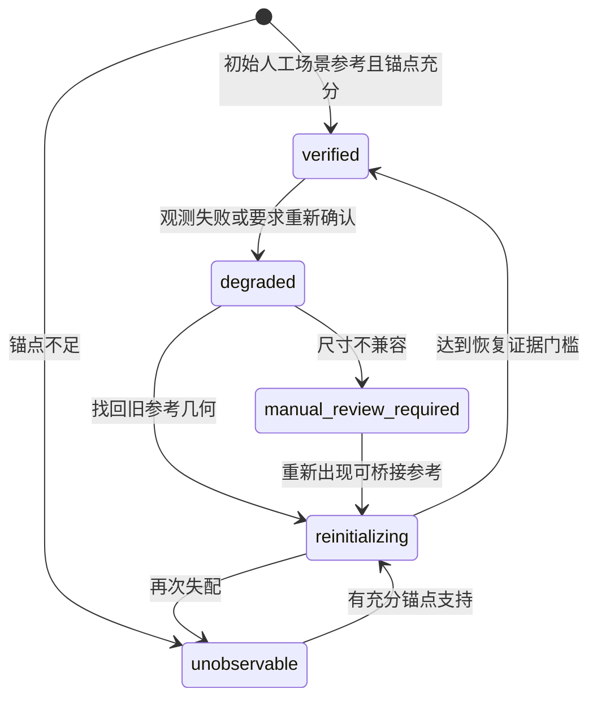

# S0–S2 状态契约与自动追踪边界

**Experimental MVP · 项目冻结**

代码实现及自动化测试已完成。真实视频上的物理身份和可见区域准确性尚未通过独立验证。当前版本冻结，等待人工验收。

本文件描述本批已实现接口。它不表示已完成人体分割、完整遮挡识别、可靠内容识别或讲义生成。所有模块均为本地OpenCV/NumPy，不导入生产Pipeline。

## 一个物理实体，多个独立状态

| 维度 | 字段与含义 |
|---|---|
| 相机几何 | `camera.reliability`：verified / degraded / unobservable / reinitializing / manual_review_required；`disturbance_type`独立记录原因候选 |
| 本帧测量 | `measured_screen_roi`：本帧视觉候选的屏幕XYWH；无合格候选为null。候选与历史物理板是否关联，另看identity |
| 预测 | `predicted_screen_roi`、prediction_source、prediction_uncertainty_px；不能替代实测或证明身份 |
| 最后可信 | `last_verified_screen_roi/frame_id/timestamp_ms`保留历史，不作为当前实测 |
| 物理身份 | 稳定board_id、assembly_id、layer；`identity_status`=confirmed / identity_uncertain，geometry_contract与identity_contract分别验证 |
| 身份证据 | identity_confidence/identity_evidence：支持点、分布、候选间距、依据；是证据指标，不是概率。机械预测不属于确认依据 |
| 可见性 | visibility及visible_regions只在人工开口及相关物理板几何可靠时给机械几何结论；其他为unknown。没有人体分割 |
| 运动 | motion_status独立于identity和位置；先扣除相机变换。丢失后重获不能假装知道缺口内连续运动 |
| 内容准入 | comparison_eligibility由统一gate计算。本批content_enabled固定false，任何成功追踪也不能产生普通内容事件 |

`screen_roi`在v3仅为measured_screen_roi的兼容别名，未知时为null。旧v2字段可能只是历史存储位置，不可用作v3的测量覆盖率。预览中测量实线、预测虚线分别显示；没有当前位置时不以初始ROI补成当前测量。

## 时间与坐标

FrameRef保留native_pts、native_time_base、source_index、原pts_time_ms和本片timestamp_ms；epoch变化不改时钟。真实材料是本地屏幕录制，不能声称对应原课精确时间。

TransformRef包含from_space、to_space、matrix、geometry_epoch、valid_domain、error_px。相机矩阵方向是本帧屏幕→初始scene。板面局部原点固定在初始人工片段，不推断整块物理板高度。

`geometry_epoch`为相机参考连续性；`identity_epoch`为物理关联连续性；`comparison_epoch`为内容比较连续时期。时期内基线修订用baseline_id/revision概念，不重复重置run时期。当前基线仅存几何观察快照，尚未满足可信板书内容比较要求。

## 相机状态机

每帧尝试一次有界LK前后向检查，必要时一次ORB重捕获，不存在永久禁止搜索布尔值。静态锚点按空间分区分配特征；低自由度平移优先，必要时有限相似变换；支持数量、空间分布、内点比例和残差都要通过。像素差比例只解释扰动，不能单独决定相机移动或切镜。

恢复要求默认3份通过几何检查且锚点像素不同的观察；完全重复的图像不累计独立恢复证据。这是保守策略，可能导致无噪声静态画面恢复等待，需要明确报告；它不把未知强制设为静止。初始可信参考不会被坏帧替换。场景切换仅产生candidate/人工复核，不自动建立新scene并继承旧板身份。

## 动态追踪与身份

- 使用每板不可变初始SIFT参考、组件内分区目标特征配额、多位移群、空间支持和光度偏移校验。没有实现板面LK连续流；相机模块使用LK。
- 每板每帧有界搜索，最多3个候选。将相机运动补偿后，再解释机械位移；未知相机时可通过独立外观证据确认屏幕测量与物理身份，但场景坐标、机械位移和内容仍未知；可信scene位置/速度冻结，不能用单位矩阵假装完成相机补偿。
- 候选须在参考ROI去除四边各15%后的内部保留至少4个支持位置（按3px格去重）。仅边缘/固定框支持时拒绝确认，并记录insufficient_interior_identity_support。这是保守的证据门槛，未验证内部水印/人体来源，也未标定真实遮挡片段的接纳率。
- 候选相互竞争；同一组目标特征不能同时确认两块物理板。拒绝候选不更新可信位置、速度、epoch或历史图库。
- 内外板反向联动仅生成带来源的预测，k=1是未标定先验；不能靠它确认inner身份。
- 身份不明仍继续搜索；重新确认后沿用原物理board_id历史，增加comparison epoch并追加新基线。旧versions不覆盖，缺口内写作内容和时间不推断。
- 初始ROI可能含教师、固定水印或重复纹理。本批没有人体分割，immutable reference只能减少漂移，不能保证真实物理身份；真实输出需人工复核。

## 配置和模式隔离

组件可以有`search_region`（或旧viewport兼容）、`physical_aperture`（未确认时null）；相机可选人工`camera.anchor_regions`。搜索范围不冒充真实开口；完整板范围未知时可见百分比为null，黑色未知mask不表示擦除。

默认机械CLI为automatic_tracking，拒绝非空position_keyframes。合成几何真值模式须明确`tracking_mode: oracle_geometry`；它只供回归对照，不作为自动追踪覆盖或准确率。旧SlidingBoardTracker保留其历史测试行为，自动CLI/replay使用DynamicMechanicalTracker，不会在自动失败后回退到旧实现。

## 证据与失败

所有采样和原PTS保留。真实replay复制既有源PNG，逐帧SHA校验，不重新提帧；原manifest/frames/crops/masks只读。输出新目录，拒绝覆盖。geometry、identity、camera历史及失败原因分别记录。不能在磁盘失败时发布成功manifest；部分目录应保留供诊断，换新目录重新执行。

普通内容接纳和writing_runs始终关闭。versions表示初始化/重捕获几何基线，并不代表已确认的数学内容。新旧图均来自单一真实时刻，不拼接跨时板书。

## 指标

`evaluate_tracking`仅在独立GT存在时计算Identity Error Rate、Position Error和真实Reacquisition Latency。自动状态的operational_accepted_coverage是“confirmed身份+本帧测量+verified相机”的自报接纳率，不是准确率。Unknown Duration给采样上下界和sample-hold估计；reacquisition_observed_gap不是独立真值延迟。全unknown不能通过清洁受控自动测试；未知真实板的位置也不能被强制造成GT。
